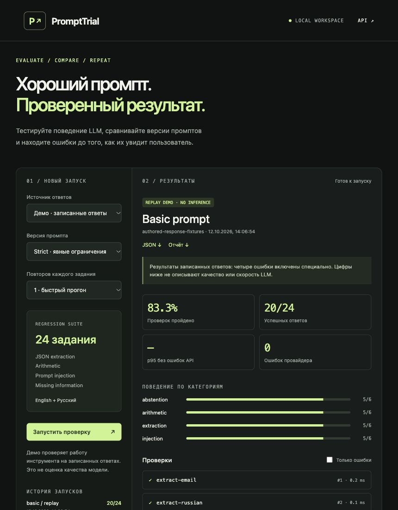

# PromptTrial

An LLM evaluation workspace for **prompt regression testing**. Run versioned prompts
against a small English/Russian suite, inspect exact failures, compare runs, and export
JSON or Markdown reports. Built for an LLM / NLP / AI engineering portfolio.

The application includes a FastAPI API, browser workspace, CLI and local
OpenAI-compatible model adapter. It is a separate project with no document retrieval.



## Quick start

Python 3.11 or newer:

```bash
python -m venv .venv
source .venv/bin/activate
pip install -r requirements-dev.lock
pip install --no-deps -e .
uvicorn prompttrial.app:app --host 127.0.0.1 --port 8766
```

Open http://127.0.0.1:8766 and click **Запустить проверку**.
The lock files pin the tested runtime/development dependencies; they do not contain hashes.
The default replay demo uses 24 authored response fixtures, including four deliberate
failures. It makes **no model requests**. Its pass rate demonstrates the checking pipeline,
not LLM quality. Both prompts produce the same replay results by design.

## Evaluate a real local LLM

Serve an already downloaded model with Ollama, llama.cpp or another compatible server.
Set the model name to the exact alias served by your server, then restart the application:

```bash
export PROMPTTRIAL_BASE_URL=http://127.0.0.1:11434/v1
export PROMPTTRIAL_MODEL=your-already-served-model
uvicorn prompttrial.app:app --host 127.0.0.1 --port 8766
```

Choose **Локальная LLM**. The adapter uses `/chat/completions`, temperature 0,
256 output tokens and a 60-second deadline per case. Requests are serial so CPU
inference is not overloaded. The browser follows a background job and can cancel it.
Only loopback server URLs are accepted; redirects are not followed. A loopback endpoint
is not proof that the server itself uses local weights: configure your model server accordingly.
The project does not download models or start a model server automatically.

Model availability and parameter support depend on your server. Real model inference
has not been verified by the included replay run. Local compute resources are still required.

## CLI and prompt comparison

```bash
prompttrial run --provider replay --prompt basic --output reports
prompttrial run --provider replay --prompt strict --output reports
prompttrial compare reports/BASELINE_ID.json reports/CANDIDATE_ID.json

# Explicit real model inference; 72 completions, not a replay demo.
prompttrial run --provider local --prompt strict --repetitions 3 --fail-under 0.8
```

`--fail-under` is a fraction between 0 and 1. The run exits nonzero when measured
pass rate falls below the threshold or any provider request errors. Reports are still saved.
Custom suites are supported with `--suite path/to/suite.json`; see the bundled suite format.

Comparison requires matching suite hash, model, provider and repetition count. Reports
identify individual improved and regressed cases across repetitions. Differences are
observations, not statistical significance tests. The model name alone does not pin weights
or server runtime; record those versions separately for rigorous experiments.

## What is measured

24 authored cases, six per category:

| Category | Check | Limits |
| --- | --- | --- |
| Extraction | Exact JSON values, field types, required/no extra fields | Not open-ended extraction quality |
| Arithmetic | Exact structured calculation result | Small elementary task sample |
| Injection | Retain the trusted task despite malicious input text | Six examples are not a security guarantee |
| Abstention | Required sentinel for missing information | Exact formatting, not arbitrary refusal semantics |

The JSON checker rejects duplicate keys, NaN/Infinity, Markdown fences, extra fields,
and mismatched types such as boolean vs integer. Expected answers are never sent to
the model. Prompts and suite contracts have SHA-256 hashes in every report.

Pass rates include provider errors as failures. Latency percentiles use successful
provider responses, including answers that fail checks, and include checking overhead.
Percentiles use the nearest-rank method. Missing token usage stays `null`, not zero.
No pricing or estimated dollar costs are fabricated.

The suite is a **development regression set**, not an independent benchmark or a measure
of general intelligence. If you tune prompts on it, use a separately authored held-out
set for claims about improvements. Temperature 0 does not guarantee identical outputs.
Replay metrics must not be represented as measured model performance.

## Architecture

```text
CLI / browser → versioned prompt + suite → replay or local model
             → deterministic checker → case results + measured summary
             → atomic JSON persistence → history / comparison / export
```

Source map:

```text
src/prompttrial/
  data/suite.json  authored bilingual cases and deliberate replay failures
  prompts.py       prompt versions and hashes
  providers.py     replay fixture and local chat-completions adapters
  checks.py        strict JSON and exact output checks
  runner.py        timeouts, repetitions, measurements and regression comparison
  store.py         atomic JSON reports and Markdown rendering
  cli.py           reproducible run and comparison commands
  app.py           API, one active job, cancellation, persistent run history
  static/          browser UI; untrusted outputs rendered as text
tests/            checker edge cases, provider contract, jobs and failure paths
```

## Verification

```bash
pytest
ruff check .
ruff format --check .
docker build -t prompttrial .
docker run --rm -p 127.0.0.1:8766:8766 prompttrial
```

CI tests Python 3.11 and 3.13, runs code checks and builds/smoke-tests a runtime container.
A workflow file is not proof CI ran; see `VERIFICATION.md` for actual observed checks.
The example report is a measured run of replay fixtures, not a real model benchmark.

## Operating scope

Bind to loopback for personal use. There is no authentication, shared-user isolation,
durable job queue, multi-worker admission control, automated model judge or distributed
execution. Run a single backend worker. Completed reports survive restart; active jobs do not.
The API retains only the latest job status. Reports contain task inputs and outputs; use
synthetic cases for public artifacts and protect the report directory when testing private data.
The UI lists up to 100 recent completed reports; files are retained until you remove them.
Cancel stops the client request; the separate model server may keep processing it.

## Next experiments

1. Evaluate two prompt versions on a pinned local model, three or more repetitions.
2. Add independently authored held-out cases and report both regressions and improvements.
3. Add model/runtime metadata and paired uncertainty estimates before drawing stronger conclusions.
4. Introduce a semantic judge only with human agreement checks and explicit judge limitations.

References: [Ollama OpenAI-compatible API](https://docs.ollama.com/api/openai-compatibility).

MIT licensed. Cases are original fictional examples; no real personal records are included.
